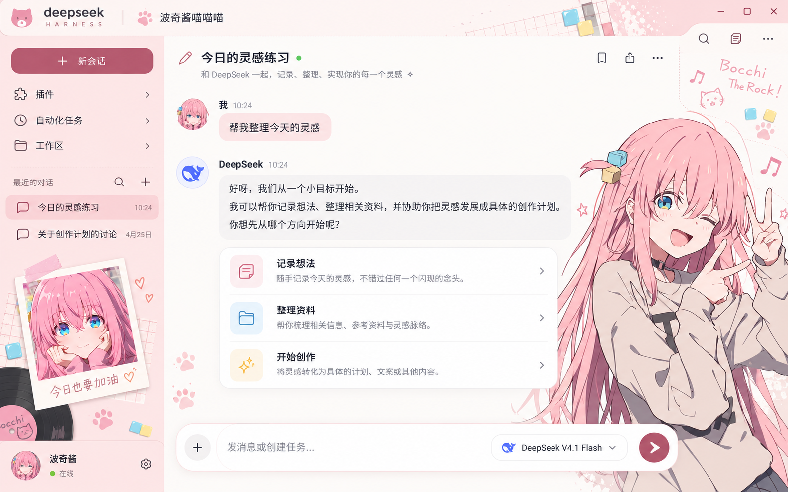

# 波奇酱喵喵喵

给 DeepSeek Harness 换上樱花粉与奶油白，把波奇立绘、拍立得和音乐手账装饰放进日常聊天。

**v1.0.0 · 试用版** ｜ 浅色 / 深色外观 ｜ 随窗口调整装饰



> **设计效果图 / 视觉参考，非当前版本实机截图。** 图中布局和示例内容用于呈现设计方向；实际主题沿用 DSH 原生导航、会话和操作控件。当前版本仍有待完成的界面验收，详见下方「兼容性与已知问题」。

**实际插件素材**

| 右侧角色立绘 | 侧栏拍立得 |
| :---: | :---: |
|  |  |

## 主题特点

- **樱花粉配色**：奶油白背景、粉色按钮与聊天气泡，搭配蓝黄发饰点缀。
- **角色与音乐装饰**：右侧波奇立绘、侧栏拍立得，以及唱片、猫爪和音符元素。
- **跟随明暗外观**：使用 DSH 自身的浅色、深色或跟随系统设置。
- **随可用空间调整**：聊天区域变窄时收起右侧装饰；角色与装饰不接收鼠标操作。
- **图片随插件提供**：素材已嵌入构建文件，使用时无需连接外部图片网站，也无需自行构建。

## 安装

### 从 GitHub 安装

1. 打开 DeepSeek Harness，在侧栏进入 **插件 → 添加插件**。
2. 粘贴下面的仓库地址，按提示完成安装。
3. 关闭其他整套界面主题，再启用 **波奇酱喵喵喵**。

```text
https://github.com/dingfz-cyber/dsh-theme-bocchi-meow
```

本仓库已包含 `lib/` 构建结果和所需素材。DSH 的 Git 地址安装方式见 [官方插件管理说明](https://github.com/deepseek-ai/deepseek-harness/blob/master/packages/client/ui-plugin-manager/README.zh.md)。

### 从本地文件夹安装

1. 在本仓库点击 **Code → Download ZIP**，将文件解压到长期保留的位置，例如 `D:\Themes\dsh-theme-bocchi-meow`。
2. 找到直接包含 `package.json`、`cordis.patch.yml` 和 `lib/` 的文件夹。
3. 在 DSH **插件 → 添加插件** 中填写该文件夹的绝对路径，安装并启用。

安装后请保留该文件夹，避免移动或删除；启用前同样需要关闭其他整套主题。

## 使用与恢复

明暗外观在 DSH 的外观设置中切换。缩小窗口或展开右侧面板时，主题会根据聊天区域的可用宽度调整装饰；较矮的窗口也会缩小或隐藏侧栏拍立得。

若要恢复默认外观，在 **插件** 中关闭 **波奇酱喵喵喵**。若要换回其他主题，关闭本主题后再启用对应插件。聊天、模型选择和设置操作仍由 DSH 原生控件提供。

## 兼容性与已知问题

| 项目 | 当前情况 |
| --- | --- |
| 主题版本 | 1.0.0，试用版 |
| 已有实装记录 | Windows 桌面版 DeepSeek Harness 0.2.1-rc.3，曾安装并显示 |
| 其他系统与 DSH 版本 | 尚未验证 |
| 已有会话正文宽度 | 曾出现正文过窄；代码已加入修正，修正后的最终界面验收尚未完成 |

安装后建议查看新会话与已有聊天，并检查输入框、模型菜单、明暗切换和窗口缩放。若正文仍过窄或控件显示异常，可先关闭主题恢复原生外观。需要重启 DSH 时，请等正在运行的任务结束后再退出。

发现问题可 [提交 Issue](https://github.com/dingfz-cyber/dsh-theme-bocchi-meow/issues/new)，附上 DSH 版本、操作系统、复现步骤和窗口大小；如提供截图，请先遮挡聊天内容与账号信息。

## 开发

需要 **Node.js 20 或更新版本**。构建脚本仅使用 Node.js 内置模块，无需安装额外 npm 依赖。

```sh
node scripts/build.mjs
node --check lib/index.js
node --check lib/client.js
```

修改 `src/` 或 `assets/` 后，重新构建，并将更新后的 `lib/client.js` 一起提交。通过 GitHub 安装时使用仓库内的构建结果。

| 路径 | 用途 |
| --- | --- |
| `src/` | 可编辑的客户端逻辑与主题样式 |
| `assets/` | 角色、拍立得和装饰 PNG |
| `lib/` | 可直接加载的构建结果 |
| `locale/` | 中文与英文插件名称、描述 |
| `cordis.patch.yml` | DSH 组合包加载入口 |
| `preview/` | README 使用的设计效果图 |

## 素材与许可

本项目为个人主题作品。原始角色参考由用户提供，主题素材依据参考与确认的设计生成；原始参考图未包含在本仓库中。

角色及美术权利归相应权利人。本仓库不授予原角色、参考图或衍生美术素材的再分发、商业使用许可，具体说明见 [LICENSE](LICENSE)。
